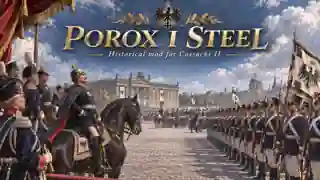

# POROX I STEEL — Порох и Сталь

**Исторический мод для «Казаков II» (Cossacks II)**

**Текущая сборка:** `0.0.8 ALFA` · **Austria patch:** `0.1`

## О моде

**«Порох и Сталь»** — модификация, вдохновлённая патчмодом **«Порох»**. Проект развивает идеи оригинальной игры: национальные стратегии, разнообразные войска, экономику, строительство и масштабные сражения. Первая версия создавалась автором во время отпуска.

## Особенности

- **Новые войска** и отдельный класс подразделений — **гвардейцы**.
- **Улучшения экономики и армии:** новые варианты развития и усиления войск.
- **Больше пользы от зданий:** постройки дают не только жильё, но и другие полезные ресурсы.
- **Разные страны — разные стратегии:** национальные особенности развития и тактики применения войск.
- **Усиленный Египет:** теперь это полноценный опасный противник.
- **Полностью переработанный ИИ:** сняты ограничения на численность войск, поэтому боты способны формировать очень крупные армии.

## Важно о производительности

**Не рекомендуется ставить более двух «тяжёлых» ИИ против себя.** Они могут создать столько юнитов, что движок Cossacks II не выдержит нагрузку.

## Статус разработки

Это **альфа-версия**. Перед игрой рекомендуется разобраться в новых механиках. Ошибки и сообщения о багах можно оставлять автору через [Issues](../../issues).

**Работа над модом продолжается. Следующий билд — в разработке.**

---

Текстовое описание и изображение находятся в папке [README](README/).
